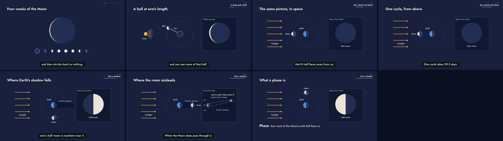
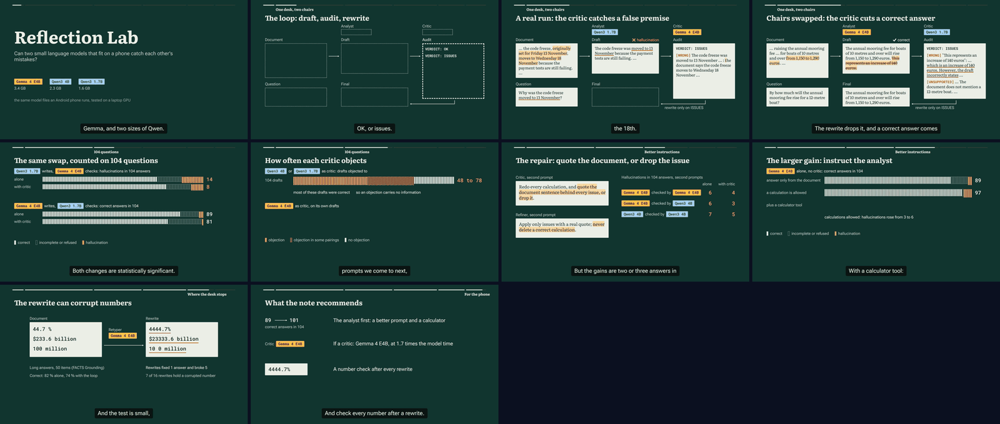

# Scene Lab

Scene Lab is a local engine that a Claude Code session drives to make narrated explainer videos, one to about
twelve minutes long, from a topic, a report or a web page. Each video is directed and designed for its topic: the
session decides the audience, the order, the look and whether the pictures are 2D or 3D, and it draws the scenes
that carry the explanation as code on a small kit. A limit you state, such as "2D only" or "no Blender", is written
into the video's spec, and the build refuses a scene that breaks it.



The contact sheet of `videos/moon-phases-2d`: one frame per scene, 87 seconds in all. make.py writes such a sheet
with every preview and every render.

## What you need

- Windows 11. Scene Lab was built and tested on Windows 11 only. macOS and Linux are untried: the setup script is
  PowerShell and the commands in the docs use Windows paths.
- Python 3.12, with the `py` launcher. Kokoro, the voice library, does not install on 3.13.
- Node 24. No other version has been run.
- ffmpeg and ffprobe on the PATH. Version 7.1.1 was used.
- Git. Claude Code, if you want a session to make the videos.
- About 2.5 GB of disk for the Python environment, the Node packages, the headless browser and the voice model.
- Blender is optional, for a still that needs real materials and light: docs/blender.md says how to add it.

No GPU is needed and no API key, because the voice runs on the CPU of your own machine. On a machine with 8 GB of
memory or less, add `--concurrency 2` to a render, so that fewer browser tabs draw frames at once. Setup downloads a headless
Chrome, and the first narration downloads the voice model (about 330 MB) and a small spaCy model. Icons and fonts
are fetched when a video uses them and are kept in a local cache.

## Install

```powershell
git clone https://github.com/Black-Lights/scene-lab.git
cd scene-lab
.\setup.ps1
.venv\Scripts\python make.py videos\_demo --preview
```

setup.ps1 makes the Python environment in `.venv`, installs the Python and Node packages and the headless browser,
and copies the Claude Code skill `explainer-video` into your skills folder with the path of this folder written
into it. If PowerShell refuses to run the script (a copy from a ZIP download is marked as downloaded), run
`powershell -ExecutionPolicy Bypass -File setup.ps1` instead. The last command is the smoke test: it renders the template
demo, a video of about three minutes, at half size into `videos\_demo\out`; the run takes five to seven minutes.

Pictures and sounds from providers are optional. setup.ps1 makes `.env` from `.env.example` with every key empty;
add the keys you have there. docs/asset-sources.md lists the providers. With no key at all the engine and every
demo work.

## Make a first video

With Claude Code, open a session in any project and ask:

> make a 90 second video on why the Moon has phases, 2D only, no Blender

The skill takes the session through the work. The session reads SPEC.md and FEEDBACK.md, directs the video, writes
`videos\<slug>\spec.json` and the scene code, checks each scene on a strip of frames, renders the video and hands
you the MP4. The example `videos/moon-phases-2d` came from a request like this one.

By hand, the same example shows what the engine does with a finished spec:

```powershell
.venv\Scripts\python make.py videos\moon-phases-2d --no-render   # checks the spec, the cues and the scene code
.venv\Scripts\python make.py videos\moon-phases-2d --strip 4     # frames of scene 4 in one image
.venv\Scripts\python make.py videos\moon-phases-2d               # the video at 1080p and 30 fps
```

The video is `videos\moon-phases-2d\out\moon-phases-2d.mp4`. Subtitles and a transcript are in `out\text`, the
strip is `out\strip-04.png` and the contact sheet is `out\sheet.png`. For a video of your own, write
`videos\<slug>\spec.json` as SPEC.md describes.

## How it works

- **spec.json** is the script of a video: the narration scene by scene, what each scene shows, and every change
  that waits for a spoken word (a `cue`).
- **The direction block** at the top of the spec records the audience, the form (2D, 3D or mixed) and the reasons
  for the order and the look. It also carries the limits you stated. There are six: `2d-only`, `no-blender`,
  `no-stock-pictures`, `templates-only`, `no-templates` and `stock-look`. The build reads what each scene really
  draws, from its code and its assets, and stops when a limit is broken. A wish that no build can check is printed
  back in the report, to be checked by eye.
- **The kit** is what scene code is written on. A scene is a React component in `videos\<slug>\scenes`, and the kit
  gives it a clock, beats tied to spoken words, a 2D board and a 3D stage with a camera, labels, and parts to draw
  with. Fixed templates (a chart, a timeline, a diagram, a quotation and others) cover the scenes where one of them
  is the right picture.
- **The voice** is Kokoro, running locally. It returns the time of every word, and those times place the cues and
  the burned-in subtitles. Narration is cached per scene.
- **The render** is Remotion drawing frames in a headless Chrome, and ffmpeg encoding them. Every picture depends
  on the frame number alone, with no random numbers and no clock. A lint refuses scene code that breaks this.
- **The checks** come before the render. `--no-render` checks the direction, the limits, every cue, the lint and
  the types. `--strip` and `--still` show one scene as one image. Every run ends with a JSON report of errors and
  warnings, and a run with an error exits with code 1.

## Examples

Both are in the repository with their spec, their scene code and their ledger of assets. Each was made by a
session that had only the skill.

- `videos/moon-phases-2d`, 1:27, 7 scenes in 3 chapters. It explains why the Moon has phases to someone with no
  astronomy. The request said "2D only" and "no Blender", and the build held the video to both. Six of its scenes
  are views of one drawing, the orbit seen from above beside the disc seen from Earth, so the picture carries on
  from scene to scene.
- `videos/reflection-lab-free`, 3:01, 10 scenes in 5 chapters, all of them scene code. It explains a research note
  on whether two small language models can catch each other's mistakes. The note is its `source.md`, taken from
  github.com/Black-Lights/reflection-lab. The models' answers are quoted on sheets, and every count out of 104
  questions is drawn as a strip of 104 cells.



The demos are smaller things to copy from: `videos/_demo` uses every template, and the `videos/_kit_*` folders show
the kit on everyday subjects such as a garden shed and a week in a bakery.

## What it costs

Time, measured on a laptop with 16 GB of memory. A 1080p render takes about 1.6 times the length of the video: the
template demo took 260 s when it ran 2:39. The 4K master at 60 fps takes about 6 times the length for a 2D video and 9 to
10 times with 3D scenes. A 12-minute video at 4K took 71 minutes when it was mostly 2D and 125 minutes when it
was mostly 3D. At 30 fps the same two took 36 and 65 minutes.

Tokens: nobody has counted them for a whole video yet, so there is no number here. What is known is where they go,
which is scene code. One session carries about three to four minutes of video drawn in scene code. A video of
about ten minutes with 27 drawn scenes took five agents: a planner, three builders and a checker. A video on
templates alone is one spec with no scene code, at any length, in one session. A session reads SPEC.md,
FEEDBACK.md and the kit pages its video needs, never the engine's code, and it looks at pictures one image at a
time.

## Licence

Scene Lab is licensed under Apache-2.0. Copyright 2026 Ammar Mughees. See LICENSE and NOTICE.

That licence covers Scene Lab's own code only. Remotion, which renders every video, is not open source. It is free
for individuals, for organisations with up to 3 employees, for non-profits and for anyone still evaluating it, and
every other organisation needs a Remotion Company License: https://www.remotion.dev/docs/license. Remotion's
licence FAQ adds that five kinds of organisation must ask Remotion for written permission before they use it for
free: government and public-sector bodies, educational institutions, commercial subsidiaries, trade associations
and industry groups, and organisations that mainly serve commercial interests
(https://www.remotion.dev/docs/license/faq). THIRD-PARTY.md lists everything else that is installed or fetched,
with its licence: the npm and Python packages, the voice model, the fonts, the icon sets and the asset providers.

## Status

Version 0.4.0 is the first public release, and `make.py --version` prints the version you have. While the number
starts with 0, the spec format and the kit's exports may still change. A change that breaks an existing spec or
scene raises the minor number and is named in CHANGELOG.md.

Not there yet: music and a sound mix, macOS and Linux, a test suite beyond the smoke test, a vertical format.

## Read on

- SPEC.md: how to direct a video and write its spec, with every template and block.
- docs/kit/README.md: the kit page by page, every export, and what is not built.
- FEEDBACK.md: the numbered rules every video follows. Yours go below them.
- docs/workflows.md: how to split a long video over several agents so that a run that is cut off is continued.
- CONTRIBUTING.md: how to report a fault and what a change must keep.

Faults and questions go to the issues of github.com/Black-Lights/scene-lab.
